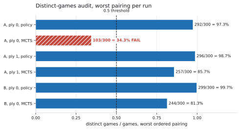
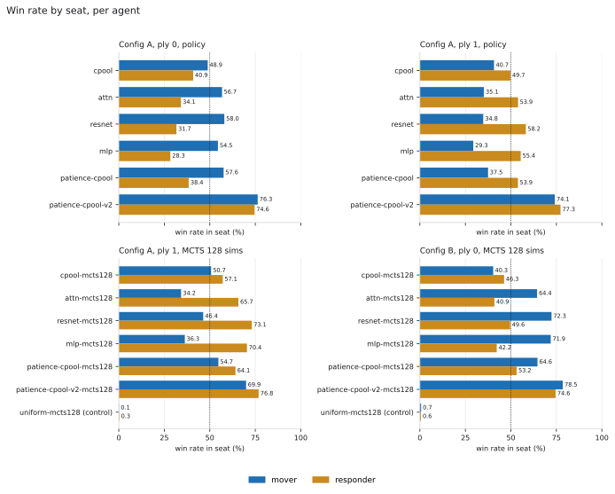
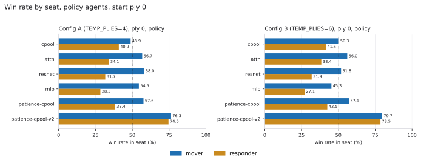

# Opening arena from ply 0 and ply 1: measured results

This document records what the ply-0 and ply-1 arena runs measured. Sections 1
to 5 contain no interpretation; sections 6 and 7 read them. The arena was run with `scripts/evaluate_opening_arena.sh`,
which is not modified.

The distinct-games audit comes first, because every win rate below depends on it.

## 1. Distinct-games audit

Each row is one run, one start ply, and one agent family. The "worst pairing"
is the ordered pairing with the lowest distinct-games ratio, as printed by
`quantik_models.arena.autoplay` (`distinct games: worst pairing N/GAMES`).
The distinct count is the number of different action sequences among the 300
games of a pairing.

The pass rule is the threshold in `autoplay.py`, which prints its WARNING when
the worst-pairing ratio is below 0.5. No other threshold was set for this
document. The raw counts are given so another cutoff can be applied to them.

| Config | Start ply | Family | Pairings x games | Worst pairing (distinct/games) | Worst ratio | Distinct across pairings (min / median / max) | Audit |
|---|---|---|---|---|---|---|---|
| A | 0 | policy | 30 x 300 | resnet vs patience-cpool-v2: 292/300 | 97.3% | 292 / 300 / 300 | pass |
| A | 0 | MCTS (128 sims) | 42 x 300 | cpool-mcts128 vs patience-cpool-v2-mcts128: 103/300 | 34.3% | 103 / 208.5 / 279 | **FAIL: not reportable** |
| A | 1 | policy | 30 x 300 | patience-cpool-v2 vs mlp: 296/300 | 98.7% | 296 / 300 / 300 | pass |
| A | 1 | MCTS (128 sims) | 42 x 300 | uniform-mcts128 vs cpool-mcts128: 257/300 | 85.7% | 257 / 288 / 298 | pass |
| B (rerun, TEMP_PLIES=6) | 0 | policy | 30 x 300 | resnet vs patience-cpool-v2: 299/300 | 99.7% | 299 / 300 / 300 | pass |
| B (rerun, TEMP_PLIES=6) | 0 | MCTS (128 sims) | 42 x 300 | cpool-mcts128 vs patience-cpool-v2-mcts128: 244/300 | 81.3% | 244 / 290.5 / 300 | pass |

Config A, start ply 0, MCTS fails the audit. Its win rates are not reported
anywhere in this document, and its seat split is omitted too. Its data remain
on disk at `runs/eval/opening-ply0/mcts-p0/games.json`. Config B was run
because of this failure. Its MCTS cell at start ply 0 passes the same rule, as
recorded above. Config B is a separate configuration. It does not replace
Config A, and Config A's failed cell stays not reportable.



Worst-pairing distinct-games ratio for each of the six cells in the table
above. The dashed vertical line is the 0.5 threshold in `autoplay.py`. The one
cell below it, Config A at start ply 0 with MCTS, is hatched and labelled
FAIL.

## 2. Runs

Output directories (gitignored, so present only where the runs were made):

- Config A: `runs/eval/opening-ply0`
  - `policy-p0`, `policy-p1`, `mcts-p0`, `mcts-p1`
  - the `p<N>` suffix is the start ply, not a seat
- Config B (rerun): `runs/eval/opening-ply0-tp6`
  - `policy-p0`, `mcts-p0`
  - start ply 0 only (`START_PLIES=0`)

Command for Config A. The run record gives no environment overrides, so the
script defaults apply. The console logs were lost, so this is not re-verified:

```sh
scripts/evaluate_opening_arena.sh runs/eval/opening-ply0 \
  cpool=runs/train/swept-cpool/best attn=runs/train/swept-attn/best \
  resnet=runs/train/lineup-resnet/best mlp=runs/train/lineup-mlp/best \
  patience-cpool=runs/train/patience-cpool/best \
  patience-cpool-v2=runs/train/patience-cpool-v2/best
```

Command for Config B:

```sh
START_PLIES=0 TEMP_PLIES=6 scripts/evaluate_opening_arena.sh runs/eval/opening-ply0-tp6 \
  cpool=runs/train/swept-cpool/best attn=runs/train/swept-attn/best \
  resnet=runs/train/lineup-resnet/best mlp=runs/train/lineup-mlp/best \
  patience-cpool=runs/train/patience-cpool/best \
  patience-cpool-v2=runs/train/patience-cpool-v2/best
```

Parameters, as recorded in each run's `games.json` and `agents-*.json`:

| Parameter | Config A | Config B |
|---|---|---|
| Seed | 20261001 | 20261001 |
| GAMES (per ordered pairing) | 300 | 300 |
| MCTS_SIMS | 128 | 128 |
| TEMP | 1.0 | 1.0 |
| TEMP_PLIES | 4 | 6 |
| START_PLIES | 0 and 1 | 0 |
| Policy games per start ply | 9,000 (30 pairings) | 9,000 (30 pairings) |
| MCTS games per start ply | 12,600 (42 pairings) | 12,600 (42 pairings) |

The MCTS arm includes the `uniform-mcts128` control (uniform priors, value
zero, same search settings) alongside the six network agents.

Agents, in the order the spec files list them: cpool, attn, resnet, mlp,
patience-cpool, patience-cpool-v2. Each has its own checkpoint under
`runs/train/*/best`. The checkpoints are not hashed here.

The seed is not a training seed. A search of the repo docs, scripts, src and
tests, the workspace tasks and context, and `runs/train` found no use of
20261001 as a training seed. The seed is reserved for this arena in the
workspace packets. The initiative plan also contains a GAMES=6 smoke command with this
seed. This document does not examine whether that smoke run produced output.

## 3. Leaderboards

Win rates are split by seat and are never pooled. "Mover" is the agent that
makes the first engine-chosen move from the start position, which is
`play_recorded`'s `mover`. At start ply 0 that is the first side to move from
the empty board. At start ply 1 one random ply has already been played, and
that ply is not attributed to either agent. The mover is therefore the side
that moves second in the full game. "Responder" is the other agent.

Each rate is wins over games in that seat. Denominators: a policy agent is
mover or responder in 5 opponents x 300 = 1,500 games per seat. An MCTS agent
is in 6 x 300 = 1,800 games per seat, and those include the games against
`uniform-mcts128`. Rows are in spec order, not sorted by rate. The arena's
printed leaderboard pools both seats and is not reproduced here.

The figures in this section are generated by `scripts/plot_opening_arena.py`
from the `games.json` files of the two run directories. They plot only the
numbers in the tables below.

Rates are computed from the `results` list in each `games.json` with the
arena's `Game` class. The stored `distinct_games` values were compared with a
recomputation for all six output directories and matched. The stored pooled
leaderboard was not compared in this pass.



Mover and responder win rate per agent, as in the tables below, for Config A
policy at start ply 0, Config A policy at start ply 1, Config A MCTS at start
ply 1, and Config B MCTS at start ply 0. Each bar is wins over games in that
seat. The dotted line marks 50%. The `uniform-mcts128` control is the last row
of each MCTS panel. Config A MCTS at start ply 0 failed the audit and is not
plotted.



The start-ply-0 policy tables for Config A (TEMP_PLIES=4) and Config B
(TEMP_PLIES=6), drawn side by side on the same axis.

### Config A, start ply 0, policy (audit: pass)

| Agent | Mover: wins/games | Mover rate | Responder: wins/games | Responder rate |
|---|---|---|---|---|
| cpool | 733/1500 | 48.9% | 613/1500 | 40.9% |
| attn | 851/1500 | 56.7% | 512/1500 | 34.1% |
| resnet | 870/1500 | 58.0% | 475/1500 | 31.7% |
| mlp | 817/1500 | 54.5% | 425/1500 | 28.3% |
| patience-cpool | 864/1500 | 57.6% | 576/1500 | 38.4% |
| patience-cpool-v2 | 1145/1500 | 76.3% | 1119/1500 | 74.6% |

### Config A, start ply 0, MCTS (audit: FAIL, not reportable)

No win rates. See section 1.

### Config A, start ply 1, policy (audit: pass)

| Agent | Mover: wins/games | Mover rate | Responder: wins/games | Responder rate |
|---|---|---|---|---|
| cpool | 611/1500 | 40.7% | 746/1500 | 49.7% |
| attn | 527/1500 | 35.1% | 809/1500 | 53.9% |
| resnet | 522/1500 | 34.8% | 873/1500 | 58.2% |
| mlp | 440/1500 | 29.3% | 831/1500 | 55.4% |
| patience-cpool | 562/1500 | 37.5% | 808/1500 | 53.9% |
| patience-cpool-v2 | 1112/1500 | 74.1% | 1159/1500 | 77.3% |

### Config A, start ply 1, MCTS 128 sims (audit: pass)

| Agent | Mover: wins/games | Mover rate | Responder: wins/games | Responder rate |
|---|---|---|---|---|
| cpool-mcts128 | 913/1800 | 50.7% | 1028/1800 | 57.1% |
| attn-mcts128 | 616/1800 | 34.2% | 1183/1800 | 65.7% |
| resnet-mcts128 | 835/1800 | 46.4% | 1316/1800 | 73.1% |
| mlp-mcts128 | 653/1800 | 36.3% | 1268/1800 | 70.4% |
| patience-cpool-mcts128 | 985/1800 | 54.7% | 1154/1800 | 64.1% |
| patience-cpool-v2-mcts128 | 1259/1800 | 69.9% | 1383/1800 | 76.8% |
| uniform-mcts128 (control) | 2/1800 | 0.1% | 5/1800 | 0.3% |

### Config B (rerun, TEMP_PLIES=6), start ply 0, policy (audit: pass)

| Agent | Mover: wins/games | Mover rate | Responder: wins/games | Responder rate |
|---|---|---|---|---|
| cpool | 754/1500 | 50.3% | 622/1500 | 41.5% |
| attn | 840/1500 | 56.0% | 576/1500 | 38.4% |
| resnet | 777/1500 | 51.8% | 478/1500 | 31.9% |
| mlp | 679/1500 | 45.3% | 406/1500 | 27.1% |
| patience-cpool | 857/1500 | 57.1% | 637/1500 | 42.5% |
| patience-cpool-v2 | 1196/1500 | 79.7% | 1178/1500 | 78.5% |

### Config B (rerun, TEMP_PLIES=6), start ply 0, MCTS 128 sims (audit: pass)

| Agent | Mover: wins/games | Mover rate | Responder: wins/games | Responder rate |
|---|---|---|---|---|
| cpool-mcts128 | 725/1800 | 40.3% | 833/1800 | 46.3% |
| attn-mcts128 | 1159/1800 | 64.4% | 737/1800 | 40.9% |
| resnet-mcts128 | 1302/1800 | 72.3% | 893/1800 | 49.6% |
| mlp-mcts128 | 1294/1800 | 71.9% | 760/1800 | 42.2% |
| patience-cpool-mcts128 | 1163/1800 | 64.6% | 957/1800 | 53.2% |
| patience-cpool-v2-mcts128 | 1413/1800 | 78.5% | 1342/1800 | 74.6% |
| uniform-mcts128 (control) | 12/1800 | 0.7% | 10/1800 | 0.6% |

## 4. Wall-clock time and provenance

- **Wall-clock time is unknown.** The console logs of both runs were lost.
  The only timestamps available are last-write times of the output files,
  which are not durations. They are given in local time for the record:
  - Config A: `agents-policy.json` last written 17:04:33; `policy-p0/games.json`
    17:06:55; `policy-p1/games.json` 17:09:06; `mcts-p0/games.json` 18:01:59;
    `mcts-p1/games.json` 18:45:39.
  - Config B: `agents-policy.json` last written 20:40:57; `policy-p0/games.json`
    20:43:09; `mcts-p0/games.json` 21:31:55.
  - The Config A policy-p0 file was written 2 min 22 s after the spec file, and
    policy-p1 2 min 11 s after policy-p0. Neither matches the roughly 35-minute
    policy-arena estimate in
    `quantik-workspace/tasks/active/QW-024-opening-arena-from-ply-zero/status.md`.
    The timestamps are therefore not used as timings.
- **Code and environment for the original runs were not recorded.** The
  commit of `quantik-models-py` and the Python environment used for Config A
  and Config B are unknown. The script's default is `PYTHON=.venv/bin/python`.
- **Recomputation code.** The recomputation imported
  `src/quantik_models/arena/autoplay.py` using the repo venv. The branch's copy of
  that file was diffed against the copy that was imported, and the files were
  identical.

## 5. Limits of this document

- **One training seed per checkpoint.** No margin in this document has a
  run-to-run error bar. Every checkpoint was trained once.
- **Rates are over games, not distinct games.** The distinct counts in section
  1 show how many of the 300 games in each pairing differ. Sections 1 to 5
  compute no confidence intervals; section 6 computes them from the tables.
- **Config B is not a replacement for Config A.** It is a separate
  configuration with its own audit. Config A's MCTS cell at start ply 0 remains
  not reportable.

## 6. Reading

**There is no full strength ordering between the checkpoints at ply 0: `patience-cpool-v2` is separable from the other five in every reportable table, and those five are not reliably ordered among themselves, though all six are far above the uniform-priors control.**

Method. Every interval below is a 95% normal approximation, 1.96 x sqrt(p(1-p)/n),
on a single seat rate from the section 3 tables (n = 1,500 for policy, 1,800 for
MCTS). That is about +/-2.5 points for a policy rate near 50% and +/-2.3 for MCTS.
A difference between two agents in the same seat is judged against the
root-sum-square of the two half-widths, about 3.5 points for policy and 3.1 for
MCTS. Two limits make these intervals optimistic: each agent's games are 300 per
opponent rather than independent draws, and each checkpoint was trained once, so
a gap between checkpoints is not a gap between architectures. A difference inside
its interval is called indistinguishable, never an order. No rate below pools the
two seats; where a "balanced mean" appears it is the unweighted average of the two
seat rates, which have equal denominators.

**1. `patience-cpool-v2` is above everything else, in both seats.** Its margin
over the best other agent in the same seat, per table:

| Table | Mover seat | Responder seat |
|---|---|---|
| A, start ply 0, policy | 76.3 vs 58.0 (+18.3) | 74.6 vs 40.9 (+33.7) |
| A, start ply 1, policy | 74.1 vs 40.7 (+33.4) | 77.3 vs 58.2 (+19.1) |
| A, start ply 1, MCTS | 69.9 vs 54.7 (+15.2) | 76.8 vs 73.1 (+3.7) |
| B, start ply 0, policy | 79.7 vs 57.1 (+22.6) | 78.5 vs 42.5 (+36.0) |
| B, start ply 0, MCTS | 78.5 vs 72.3 (+6.2) | 74.6 vs 53.2 (+21.4) |

Every margin exceeds its interval. The smallest, +3.7 for A start ply 1 MCTS
responder, clears a half-width of about 2.8 only narrowly. Config A MCTS at start
ply 0 is excluded (audit failure). The v2 gap is the one result that holds across
configs, start plies, seats and policy versus MCTS.

**2. The other five (cpool, attn, resnet, mlp, patience-cpool) are not a ladder.**
- *Rank depends on seat.* In A start ply 0 policy, cpool is last as mover (48.9;
  below resnet 58.0, attn 56.7, patience-cpool 57.6 and mlp 54.5, each gap larger
  than the 3.5 interval) and first or tied-first as responder (40.9, against
  resnet 31.7 and attn 34.1 with cpool above both beyond the interval, and
  indistinguishable from patience-cpool 38.4). Against resnet alone the sign flips
  with both gaps outside noise: -9.1 as mover, +9.2 as responder. A start ply 1
  MCTS flips cpool against attn the same way: mover 50.7 vs 34.2, responder 57.1 vs
  65.7. The flip is not present in every table (in B start ply 0 policy cpool
  is not above resnet as mover but still above as responder), so the claim is that
  the order is seat-dependent, not that it flips everywhere.
- *Rank depends on search.* With policy only, mlp is lowest or tied-lowest as the
  second player of the full game in all three tables (A start ply 0 responder 28.3,
  tied with resnet 31.7 within the interval; A start ply 1 mover 29.3, below resnet
  34.8 and attn 35.1; B start ply 0 responder 27.1, below resnet 31.9). With MCTS it is
  not: in B start ply 0 cpool is lowest as mover (40.3, against 64.4 to 72.3 for the
  other four) and attn and mlp are lowest as responder (40.9 and 42.2, indistinguishable).
- *Rank depends on TEMP_PLIES.* Config A and Config B differ only in TEMP_PLIES
  (4 versus 6) at start ply 0 policy. The same checkpoint moves by more than the
  between-agent differences: mlp as mover 54.5 to 45.3 (-9.2), resnet as mover 58.0
  to 51.8 (-6.2), both beyond the 3.5 interval. So the order among the five
  is not a property of the checkpoints alone; it moves with the opening randomisation.
- *The balanced means of the five are close.* Policy, A start ply 0: patience-cpool
  48.0, attn 45.4, cpool 44.9, resnet 44.8, mlp 41.4, so attn, cpool and resnet span
  0.6 points. With MCTS the means spread more (B start ply 0: resnet 61.0,
  patience-cpool 58.9, mlp 57.1, attn 52.7, cpool 43.3) but the seat-level order behind
  them is the one that flips, as above.

**3. What the control shows.** `uniform-mcts128` (uniform priors, value zero, same
search) wins 12/1,800 as mover and 10/1,800 as responder in B start ply 0 (0.7%
and 0.6%), and 2/1,800 and 5/1,800 in A start ply 1. Every network-guided agent
beats it. The reading "search does the work and the networks are interchangeable"
is therefore rejected: with the same 128 simulations and no network, the agent
almost never wins. The control separates "a trained checkpoint" from "no
checkpoint"; it does not separate checkpoints from one another, and it cannot say
the networks differ at ply 0 itself. The control plays whole games, so its deficit
comes from every ply the network guides, not from the empty board. The packet
states the checkpoints' ply-0 priors are uniform to three decimals (max legal
prior 0.016-0.023); no table in this document measures that, so it is context, not
evidence.

**4. Start ply 0 adds nothing over start ply 1 for the policy agents.** Compare a
role-matched pair (the first player of the full game is the ply-0 mover and the
ply-1 responder). First-player rates for ply 0 and ply 1: cpool 48.9/49.7, attn
56.7/53.9, resnet 58.0/58.2, mlp 54.5/55.4, patience-cpool 57.6/53.9, v2
76.3/77.3. Second-player rates: cpool 40.9/40.7, attn 34.1/35.1, resnet 31.7/34.8,
mlp 28.3/29.3, patience-cpool 38.4/37.5, v2 74.6/74.1. All twelve differences are at
most 3.7 points; only that largest one (patience-cpool, first player) falls marginally
outside its interval of about 3.5, and the other eleven are inside it. So the
empty board and the board after one random ply give the same picture for policy
agents. The MCTS comparison is not clean: ply 0 is Config B and ply 1 is Config A,
and cpool-mcts128 as first player is 40.3 at ply 0 (B) against 57.1 at ply 1 (A),
a 16.8-point gap this document does not explain.

**5. Mover parity.** The mover is the first player at start ply 0 and the second
player of the full game at start ply 1, because one random ply has already been
played. The seat effect is large and its sign follows the full-game role, not the
word "mover": in A start ply 0 policy the mover seat wins 5,280/9,000 games, in A
start ply 1 policy it wins 3,774/9,000, i.e. the first player of the full game
wins 58.7% and 58.1% of games respectively; B start ply 0 policy gives 5,103/9,000
(56.7%). For the five non-v2 agents the gap between an agent's two seat rates is
8 to 26 points, larger than most between-agent gaps above, which is why a pooled
rate would mostly measure which seat an agent happened to fill. The figure for
`patience-cpool-v2` is the exception (76.3 and 74.6, a 1.7-point gap). Any
statement about an agent must name which seat of the full game it holds.

**Rejected readings.**
- *Search does the work, networks interchangeable.* Rejected by the control (item 3).
- *A single strength ladder of all six.* Rejected by items 2 and 5: order among the
  five changes with seat, search and TEMP_PLIES.
- *Rank by the printed pooled leaderboard or by balanced mean alone.* Rejected: the
  pooled rate is seat-confounded, and a balanced mean hides the seat reversals in
  item 2.
- *Read the failed Config A MCTS ply-0 cell, or treat Config B as its repair.*
  Rejected: no rates from the failed cell, and Config B is a separate configuration.

**What the data cannot settle.** Whether the five non-v2 checkpoints have a true
order, at any single seat and search setting, needs one or more of the following,
none of which was run here:
1. The head-to-head matrix per ordered pairing (300 games each), recomputed from the
   existing `games.json` files with no new games, to check transitivity among the five.
2. One configuration repeated with a different arena seed, to measure how much of the
   Config A / Config B movement is TEMP_PLIES and how much is sampling noise.
3. More games. Resolving a 2-point difference between two agents in one seat at
   p near 0.5 needs about 4,800 games per agent-seat (1.96 x sqrt(2 x 0.25 / n) = 0.02),
   against 1,500 now.
4. More than one training seed per architecture (QW-026 is the independent-seed work),
   to separate checkpoint from architecture.

## 7. What this unblocks in QW-010

**A ply-0-derived ladder is supportable only as a two-step one, not as easy / medium /
hard from these checkpoints.** What the evidence supports: `patience-cpool-v2` is the
top opponent in this roster (balanced mean 75.5 in A start ply 0 policy, 79.1 in B; 76.5
in B MCTS), above every other checkpoint in both seats, and uniform-priors search is a floor
(0.6% in B MCTS). It does not support placing cpool, attn, resnet, mlp or
patience-cpool at distinct levels, because their order depends on seat, search and
TEMP_PLIES (Reading, item 2). A middle tier built from those five would rank them on an
order that changes when the opening randomisation changes.

What QW-010 should do instead:
1. Use ply-1 or ply-0 numbers interchangeably for policy agents (Reading, item 4), and
   keep every number seat-labelled with the full-game role, per its own constraint.
2. Take the top level from `patience-cpool-v2`, citing the margins in item 1.
3. Source the lower levels from a dimension that moves strength by more than the
   between-checkpoint noise. The tables here show only one such dimension, network versus
   no network (the control), which is too wide a gap to make an easy level. Candidates
   already named in the initiative are the minimax and search-budget ladder in
   `docs/oracle-benchmark.md`; these were not measured here and need their own seat-balanced
   arena before they are used.
4. Treat any mapping of the five middle checkpoints as unsettled until run 1 in "What the
   data cannot settle" (zero new games) has been done; run 2 and 3 only if it is ambiguous.

Rejected for QW-010: ranking the middle five by balanced mean (the spread, 41.4 to 48.0 in
A start ply 0 policy, is not stable across configs); using the ply-3/6/9 tables as a
stand-in (already rejected in the initiative's decisions); and presenting `cpool-v3` as
an extra level (no data here concerns it).
