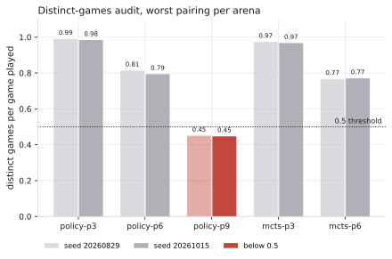
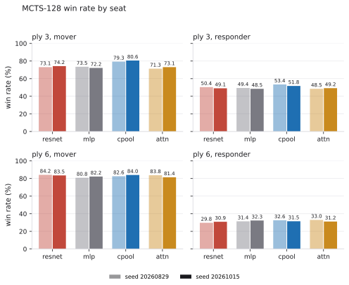
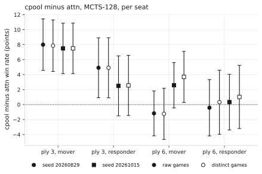

# Patience-lineup arena on an independent seed

**Verdict.** The cpool-vs-attn ranking holds at ply 3 for MCTS-128 in the mover seat against the field on both seeds (+8.0 and +7.5 points, each ±3.4; the policy-only ply-3 comparison and the cpool-vs-attn head-to-head at ply 3 are weaker, see below), and the head-to-head favours cpool at ply 6 on both seeds (+4.0 ±7.5, +7.7 ±7.1), but the 0.8-point ply-6 MCTS-128 margin does not survive: its pooled sign reverses on seed 20261015 (attn +0.8 becomes cpool +1.5), and that reversal sits inside the noise band for the pooled margin (±3.1) and for raw mover-seat rates (+2.6 ±3.0), but only marginally outside it for distinct-game mover-seat rates (+3.7 ±3.4), so two seeds do not settle ply 6.

Everything below is measured. The verdict above is the only interpretation.

## What was run

- **Original seed 20260829** (the script default QW-012 ran without overriding `SEED`): `runs/eval/patience-2026-08-30/`.
- **New seed 20261015**: `runs/eval/patience-seed-20261015/`. Its files were written between 2026-10-24 17:04:33 and 17:31:22.
- Both runs use the same four checkpoints, `runs/train/patience-{resnet,mlp,cpool,attn}/best`, and the same `scripts/evaluate_lineup.sh` with defaults `GAMES=300` and `MCTS_SIMS=128`. Policy arenas were run at start plies 3, 6 and 9; MCTS-128 arenas at start plies 3 and 6.
- This is an evaluation re-run on the same checkpoints, which come from one training seed. It measures arena-seed variance on fixed networks. It does not measure training-seed variance. Nothing was retrained and no checkpoint was modified.
- The console logs were lost. Every audit line and win rate below was recomputed from each run's `games.json` with `quantik_models.arena.autoplay` (`distinct_games`, `leaderboard`). For all ten arenas the recomputed distinct counts and leaderboards equal the values the arena stored in the same file.

## Seed check

Run before this document was written:

```text
grep -rn "20261015" scripts/ docs/ src/ runs/
```

Output, with paths shown relative to the repository root:

```text
runs/eval/patience-seed-20261015/mcts-p6/games.json:2:  "seed": 20261015,
runs/eval/patience-seed-20261015/shift.md:31:wrote runs/eval/patience-seed-20261015/shift.json
runs/eval/patience-seed-20261015/policy-p3/games.json:2:  "seed": 20261015,
runs/eval/patience-seed-20261015/policy-p6/games.json:2:  "seed": 20261015,
runs/eval/patience-seed-20261015/policy-p9/games.json:2:  "seed": 20261015,
runs/eval/patience-seed-20261015/mcts-p3/games.json:2:  "seed": 20261015,
```

All six hits are outputs of this run (its `seed` field and its `wrote` line). None is in `scripts/`, `docs/`, `src/`, or the original run. That agrees with the seed being unspent before the run. The pre-launch grep was not recorded, so this is consistency evidence, not a before-and-after check. The grep matches the literal string only.

## Original run unmodified (evidence, not proof)

The pre-run listing of `runs/eval/patience-2026-08-30/` was lost, so byte-identity cannot be shown. What can be shown: all 14 files in that directory have an mtime and a ctime between 2026-08-30 19:05:08 and 19:20:53. The new run started at 2026-10-24 17:04:33, about two months later. No file in the directory has been written, or had its metadata changed, since 19:20:53 on 2026-08-30. The directory holds the same 14 files that this script writes.

## Distinct-games audit

Ordered pairings per arena: 12 for policy, 20 for MCTS. The arena's own warning (`autoplay.py`) fires when the worst pairing falls below 0.5 distinct games per game played, so an arena is reportable only if its worst pairing is at or above 0.5. The "below 0.5" column counts how many pairings in that arena fall under the threshold.

| run (seed) | arena | ordered pairings | fewest distinct / games (pairing) | pairings below 0.5 | status |
|---|---|---|---|---|---|
| patience-2026-08-30 (20260829) | policy-p3 | 12 | 297/300 (cpool vs mlp) | 0 | reportable |
| patience-2026-08-30 (20260829) | policy-p6 | 12 | 244/300 (mlp vs cpool) | 0 | reportable |
| patience-2026-08-30 (20260829) | policy-p9 | 12 | 135/300 (resnet vs cpool) | 6 | NOT REPORTABLE |
| patience-2026-08-30 (20260829) | mcts-p3 | 20 | 292/300 (uniform-mcts128 vs attn-mcts128) | 0 | reportable |
| patience-2026-08-30 (20260829) | mcts-p6 | 20 | 230/300 (mlp-mcts128 vs uniform-mcts128) | 0 | reportable |
| patience-seed-20261015 (20261015) | policy-p3 | 12 | 295/300 (resnet vs mlp) | 0 | reportable |
| patience-seed-20261015 (20261015) | policy-p6 | 12 | 238/300 (mlp vs attn) | 0 | reportable |
| patience-seed-20261015 (20261015) | policy-p9 | 12 | 134/300 (mlp vs attn) | 4 | NOT REPORTABLE |
| patience-seed-20261015 (20261015) | mcts-p3 | 20 | 290/300 (uniform-mcts128 vs attn-mcts128) | 0 | reportable |
| patience-seed-20261015 (20261015) | mcts-p6 | 20 | 231/300 (mlp-mcts128 vs attn-mcts128) | 0 | reportable |

**Policy ply 9 is not reportable on either seed**, and no win rate for it appears in this document. The original seed's policy-p9 audit also fails (worst pairing 135/300), so the QW-012 policy-p9 numbers should not be cited either.



Worst pairing's distinct games per game played, for each arena and seed, against the 0.5 threshold. Policy ply 9 falls below it on both seeds (0.45 and 0.45), which is why it is not reportable. The two figures below leave policy ply 9 out.

## Win rates by seat, both seeds

Each cell is one agent's win rate in one seat, over all of its games in that seat against every opponent (field-relative). "Mover" is the first seat, "responder" the second. Raw rate with games in parentheses; distinct-game rate with distinct games in brackets. The distinct count is the arena's own count of different action sequences.

**policy-p3**

| agent | seed 20260829 mover | seed 20260829 responder | seed 20261015 mover | seed 20261015 responder |
|---|---|---|---|---|
| attn | 63.9% (575/900) [63.9%, 575/900] | 40.4% (364/900) [40.6%, 364/897] | 65.0% (585/900) [65.0%, 585/900] | 43.2% (389/900) [43.4%, 388/895] |
| cpool | 66.8% (601/900) [66.6%, 595/894] | 43.2% (389/900) [43.4%, 389/897] | 65.3% (588/900) [65.1%, 583/895] | 40.8% (367/900) [40.7%, 366/899] |
| mlp | 60.6% (545/900) [60.4%, 541/896] | 32.3% (291/900) [32.5%, 291/896] | 61.1% (550/900) [61.0%, 546/895] | 34.9% (314/900) [35.0%, 313/895] |
| resnet | 58.9% (530/900) [58.8%, 528/898] | 33.9% (305/900) [34.0%, 305/898] | 57.0% (513/900) [56.9%, 508/893] | 32.7% (294/900) [32.9%, 294/894] |

**policy-p6**

| agent | seed 20260829 mover | seed 20260829 responder | seed 20261015 mover | seed 20261015 responder |
|---|---|---|---|---|
| attn | 80.1% (721/900) [78.2%, 615/786] | 25.0% (225/900) [28.3%, 212/748] | 77.3% (696/900) [75.8%, 600/792] | 26.0% (234/900) [28.9%, 217/752] |
| cpool | 77.7% (699/900) [76.4%, 594/777] | 26.1% (235/900) [29.4%, 226/770] | 79.1% (712/900) [77.3%, 596/771] | 24.6% (221/900) [27.5%, 213/774] |
| mlp | 70.7% (636/900) [66.6%, 496/745] | 18.9% (170/900) [20.4%, 155/761] | 72.6% (653/900) [69.3%, 509/735] | 22.0% (198/900) [23.6%, 184/781] |
| resnet | 76.9% (692/900) [74.2%, 564/760] | 24.7% (222/900) [26.1%, 206/789] | 75.3% (678/900) [72.5%, 552/761] | 23.1% (208/900) [25.0%, 188/752] |

**mcts-p3**

| agent | seed 20260829 mover | seed 20260829 responder | seed 20261015 mover | seed 20261015 responder |
|---|---|---|---|---|
| attn-mcts128 | 71.3% (856/1200) [71.4%, 855/1198] | 48.5% (582/1200) [48.3%, 573/1186] | 73.1% (877/1200) [73.1%, 876/1199] | 49.2% (591/1200) [49.0%, 582/1187] |
| cpool-mcts128 | 79.3% (952/1200) [79.2%, 946/1194] | 53.4% (641/1200) [53.2%, 635/1193] | 80.6% (967/1200) [80.6%, 962/1194] | 51.8% (621/1200) [51.6%, 615/1192] |
| mlp-mcts128 | 73.5% (882/1200) [73.3%, 874/1192] | 49.4% (593/1200) [49.4%, 591/1196] | 72.2% (866/1200) [72.0%, 857/1190] | 48.5% (582/1200) [48.3%, 575/1191] |
| resnet-mcts128 | 73.1% (877/1200) [73.0%, 872/1194] | 50.4% (605/1200) [50.1%, 596/1190] | 74.2% (891/1200) [74.3%, 890/1198] | 49.1% (589/1200) [48.7%, 579/1189] |
| uniform-mcts128 (control) | 0.3% (4/1200) [0.3%, 4/1176] | 0.7% (8/1200) [0.7%, 8/1189] | 0.8% (9/1200) [0.7%, 8/1170] | 0.6% (7/1200) [0.6%, 7/1192] |

**mcts-p6**

| agent | seed 20260829 mover | seed 20260829 responder | seed 20261015 mover | seed 20261015 responder |
|---|---|---|---|---|
| attn-mcts128 | 83.8% (1005/1200) [82.0%, 816/995] | 33.0% (396/1200) [36.4%, 352/968] | 81.4% (977/1200) [79.4%, 802/1010] | 31.2% (374/1200) [34.3%, 337/982] |
| cpool-mcts128 | 82.6% (991/1200) [80.8%, 807/999] | 32.6% (391/1200) [36.7%, 361/984] | 84.0% (1008/1200) [83.1%, 831/1000] | 31.5% (378/1200) [35.3%, 346/979] |
| mlp-mcts128 | 80.8% (970/1200) [77.9%, 749/961] | 31.4% (377/1200) [33.7%, 340/1009] | 82.2% (987/1200) [79.9%, 766/959] | 32.3% (388/1200) [34.9%, 344/987] |
| resnet-mcts128 | 84.2% (1010/1200) [82.7%, 831/1005] | 29.8% (357/1200) [33.8%, 336/995] | 83.5% (1002/1200) [82.4%, 823/999] | 30.9% (371/1200) [34.5%, 339/984] |
| uniform-mcts128 (control) | 33.8% (406/1200) [26.1%, 248/952] | 8.1% (97/1200) [7.5%, 72/956] | 35.2% (422/1200) [26.8%, 255/952] | 7.8% (93/1200) [7.8%, 77/988] |



Each network's MCTS-128 win rate in the mover and responder seats at start plies 3 and 6, raw games, field-relative, for seed 20260829 (light) and seed 20261015 (dark). The uniform control is not drawn.

## cpool minus attn, per seat, both seeds

Each cell is cpool's rate minus attn's rate in the same seat, field-relative. The raw half-width uses game counts (what the arena would report). The distinct half-width uses distinct games, which is the independent-trial count for deterministic agents. Both are Wald 95% intervals, rough, treating each agent-seat's games as independent.

| arena | seat | seed 20260829: raw (distinct) | seed 20261015: raw (distinct) |
|---|---|---|---|
| policy-p3 | mover | +2.9 ±4.4 (+2.7 ±4.4) | +0.3 ±4.4 (+0.1 ±4.4) |
| policy-p3 | responder | +2.8 ±4.6 (+2.8 ±4.6) | -2.4 ±4.6 (-2.6 ±4.6) |
| policy-p6 | mover | -2.4 ±3.8 (-1.8 ±4.1) | +1.8 ±3.8 (+1.5 ±4.2) |
| policy-p6 | responder | +1.1 ±4.0 (+1.0 ±4.6) | -1.4 ±4.0 (-1.3 ±4.5) |
| mcts-p3 | mover | +8.0 ±3.4 (+7.9 ±3.4) | +7.5 ±3.4 (+7.5 ±3.4) |
| mcts-p3 | responder | +4.9 ±4.0 (+4.9 ±4.0) | +2.5 ±4.0 (+2.6 ±4.0) |
| mcts-p6 | mover | -1.2 ±3.0 (-1.2 ±3.4) | +2.6 ±3.0 (+3.7 ±3.4) |
| mcts-p6 | responder | -0.4 ±3.8 (+0.3 ±4.3) | +0.3 ±3.7 (+1.0 ±4.2) |



cpool minus attn per seat for MCTS-128 at plies 3 and 6, one point per seed. Filled markers use raw games and open markers use distinct games, each with its Wald 95% half-width as in the table above. The dotted line is zero. Policy arenas are not drawn.

## The 0.8-point margin, on the pooled leaderboard

The 0.8-point figure is the pooled leaderboard margin: each agent's wins over all of its games, both seats and all opponents. The rough half-width sums each agent's distinct games across its pairings. The recomputed leaderboard reproduces QW-012's ply-3 numbers (cpool 66.4, attn 59.9) and its ply-6 gap (attn ahead by 0.79).

| arena | seed | cpool | attn | cpool minus attn (pooled, ±rough) |
|---|---|---|---|---|
| mcts-p3 | 20260829 | 66.38% (1593/2400) | 59.92% (1438/2400) | +6.46 ±2.73 |
| mcts-p3 | 20261015 | 66.17% (1588/2400) | 61.17% (1468/2400) | +5.00 ±2.73 |
| mcts-p6 | 20260829 | 57.58% (1382/2400) | 58.38% (1401/2400) | -0.79 ±3.08 |
| mcts-p6 | 20261015 | 57.75% (1386/2400) | 56.29% (1351/2400) | +1.46 ±3.08 |
| policy-p3 | 20260829 | 55.00% (990/1800) | 52.17% (939/1800) | +2.83 ±3.26 |
| policy-p3 | 20261015 | 53.06% (955/1800) | 54.11% (974/1800) | -1.06 ±3.26 |
| policy-p6 | 20260829 | 51.89% (934/1800) | 52.56% (946/1800) | -0.67 ±3.53 |
| policy-p6 | 20261015 | 51.83% (933/1800) | 51.67% (930/1800) | +0.17 ±3.52 |

This pools seats and opponents, so it is not a cpool-vs-attn measurement. Its margins include games against mlp, resnet and, for MCTS, the uniform control.

## Head-to-head, cpool vs attn, seat-split

Only the games between cpool and attn (300 per seat per arena), split by who moved. Within one pairing, cpool's responder rate is 1 minus attn's mover rate, so the mover-seat and responder-seat margins are the same head-to-head quantity read from opposite seats. It is one figure, reported once.

| arena | seed | cpool moves: cpool wins, raw (distinct) | attn moves: attn wins, raw (distinct) | seat-matched margin, distinct (±) |
|---|---|---|---|---|
| mcts-p3 | 20260829 | 217/300 (215/298) | 179/300 (179/300) | +12.5 ±7.5 |
| mcts-p3 | 20261015 | 220/300 (220/300) | 199/300 (199/300) | +7.0 ±7.3 |
| mcts-p6 | 20260829 | 241/300 (190/245) | 232/300 (186/253) | +4.0 ±7.5 |
| mcts-p6 | 20261015 | 250/300 (211/256) | 236/300 (186/249) | +7.7 ±7.1 |

At ply 6 the head-to-head favours cpool on both seeds. The interval on the new seed (+7.7 ±7.1) excludes zero, and the original's (+4.0 ±7.5) does not. At ply 6 on the original seed the pooled leaderboard favours attn, while the head-to-head favours cpool. The two measures answer different questions, and they disagree in sign there.

## Limits

- **The two rate bases disagree on the ply-6 mover seat.** On raw rates the new seed's reversal (+2.6 ±3.0) is inside noise. On distinct-game rates (+3.7 ±3.4) it is marginally outside. This report states both and does not choose the tidier one.
- **The seed-to-seed change in the ply-6 mover margin** is -1.2 (original) to +2.6 (new) on raw rates, a change of +3.8 ±4.2, inside noise. On distinct-game rates it is -1.2 to +3.7, a change of +4.9 ±4.8, just outside.
- **Intervals are rough.** They are Wald intervals on game counts, treating each agent-seat's games as independent. They ignore the correlation between cpool and attn, which share their head-to-head games, and the correlation between pairings.
- **One training seed.** Each checkpoint comes from one training run, so these numbers say nothing about how much the ranking would move with another training seed.
- **Policy ply 9** is excluded on both seeds and is not used anywhere in the verdict.

## Reproduction

The tables were produced from `runs/eval/<run>/<arena>/games.json` with `quantik_models.arena.autoplay` (`distinct_games`, `leaderboard`), run under the repo venv. The tables were computed by throwaway helper scripts that are not committed; the figures are regenerated by `scripts/plot_patience_second_seed.py <original-run-dir> <new-run-dir>`, which recomputes the same quantities and reproduces the tables' numbers. The new run was launched with `SEED=20261015 scripts/evaluate_lineup.sh <dir> resnet=... mlp=... cpool=... attn=...`. The arena itself is `src/quantik_models/arena/autoplay.py`.

## Not done here

- Training-seed variance. It would need retraining, which this item rules out.
- The W2 propagation of this result into the three docs and QW-012's status and manifest is a separate work item, not part of this document.
